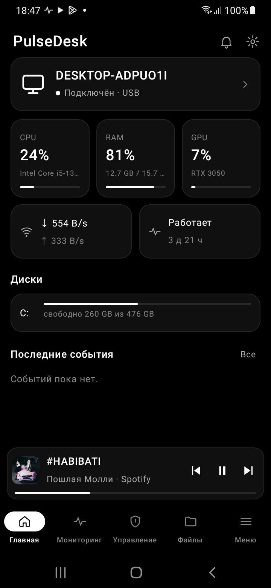
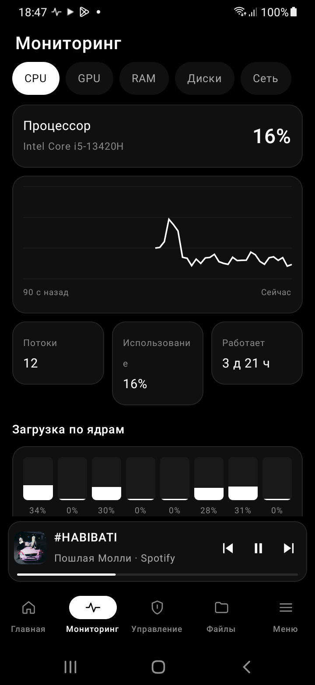
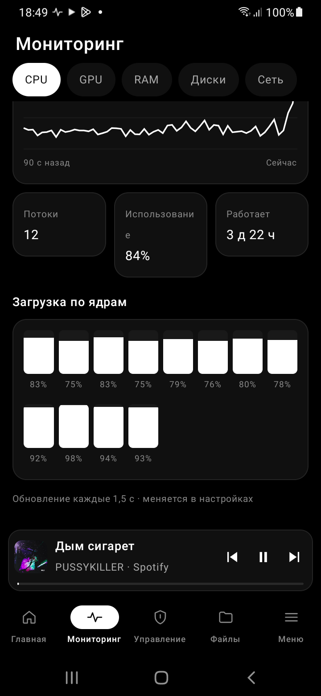
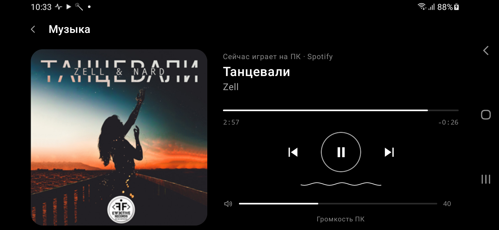
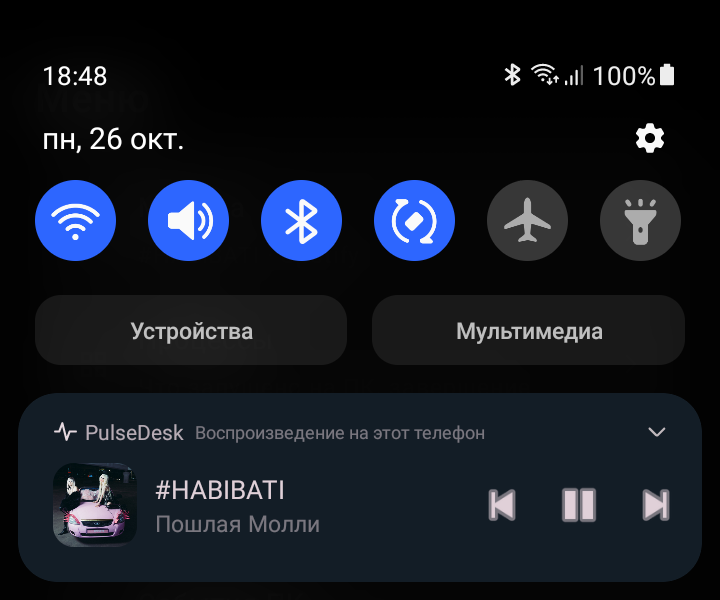
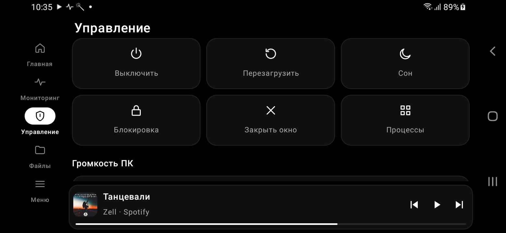
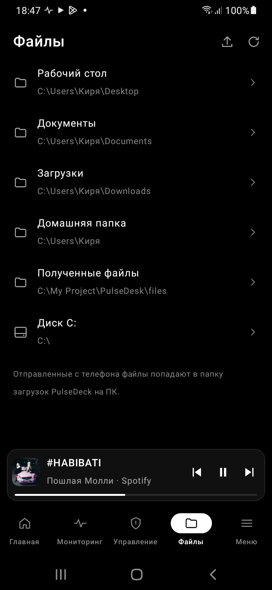
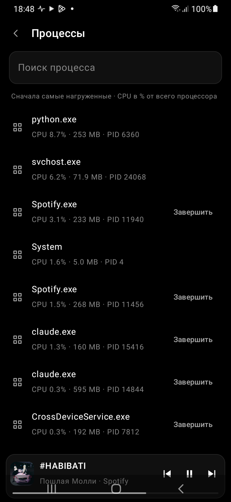
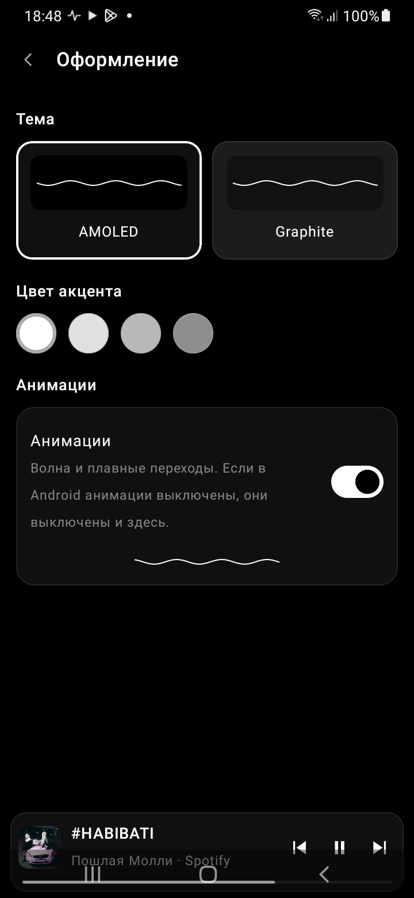
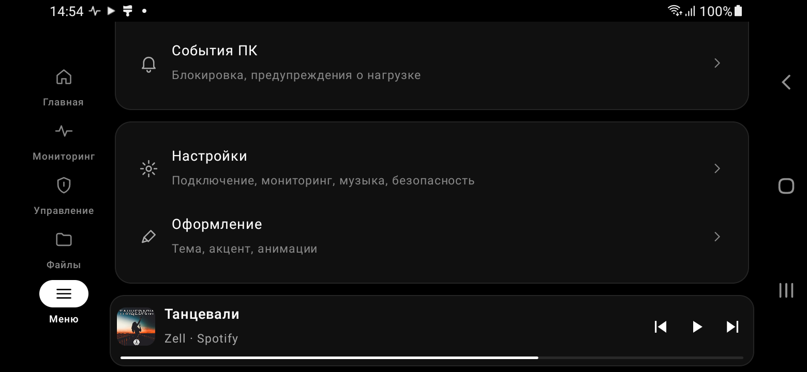

# PulseDesk

**Управление компьютером с телефона: мониторинг, музыка, файлы, процессы и питание.**

**Android 11+ · Kotlin · Jetpack Compose · Material 3 · TLS · Wi-Fi и USB**

## Что это

PulseDesk — Android-клиент программы **PulseDeck** для Windows. Он показывает, что происходит
на компьютере, и позволяет им управлять из любой точки домашней сети или по USB-кабелю.

Все данные — настоящие, с ПК. Функций, которых нет на ПК, в приложении нет совсем: ни кнопок,
ни заглушек «скоро».

## Возможности

| Экран | Что есть |
|---|---|
| **Главная** | ПК и состояние связи, CPU / RAM / GPU с названиями, сеть, время работы, диски, последние события |
| **Мониторинг** | CPU, GPU, RAM, диски, сеть; графики за последние минуты; загрузка по каждому ядру |
| **Музыка** | Что играет на ПК, обложка, перемотка, кнопки, громкость ПК; мини-плеер над вкладками |
| **Медиакарточка** | Обложка и кнопки в шторке и на экране блокировки — только пока трек играет или на паузе |
| **Управление** | Выключение и перезагрузка с задержкой и отменой, сон, блокировка, закрыть окно, громкость, окна, программы, сценарии, сайт, поиск, скриншот |
| **Файлы** | Диски и папки ПК, поиск, скачать на телефон, отправить на ПК, новая папка, переименование, удаление в корзину |
| **Процессы** | Запущенные процессы с нагрузкой и памятью, завершение (системные защищены) |
| **Устройства** | Несколько ПК, переключение, добавление, «Забыть» |
| **Оформление** | Темы AMOLED и Graphite, цвет акцента, анимации |

Опасные действия — выключение, перезагрузка, сон, блокировка, закрытие окна, завершение процесса,
удаление — всегда спрашивают подтверждение.

## Скриншоты

| | |
|---|---|
|  |  |
|  |  |
|  |  |
|  |  |
|  | |

На телефоне в книжной ориентации вкладки внизу, в альбомной — сбоку.

## Как подключить

1. На ПК установите и запустите **PulseDeck** 1.0.1 или новее.
2. Телефон и ПК в одной сети Wi-Fi — или кабель с включённой «Отладкой по USB».
3. На ПК откройте **«Телефон» → «Показать код»**.
4. В PulseDesk нажмите **«Сканировать QR-код»** и наведите камеру — всё остальное подставится само.
   Без камеры: «Автопоиск в сети» (или IP-адрес ПК), сверьте отпечаток и введите 6 цифр.

**Android 17:** при первом запуске PulseDesk попросит разрешение **«Устройства поблизости»** —
без него Android 17 запрещает приложениям связываться с устройствами в домашней сети. Если вы
отказали, разрешение можно дать позже: баннер вверху экрана → «Разрешить» или «Настройки».

На экране «Телефон» в PulseDeck можно дать телефону **полный доступ** или **только просмотр**
(показатели и музыка, без управления, файлов и скриншотов), а также отозвать его.

## Обновления

PulseDesk проверяет [релизы на GitHub](https://github.com/kirdev07/PulseDeck-Mobile--KirDev-Software/releases)
при каждом открытии (не чаще раза в час). Новая версия сразу скачивается и предлагается к установке;
установку подтверждает Android. Вручную — «Настройки» → «Обновления». Ставится только APK с той же подписью,
пары с ПК и настройки сохраняются.

## Музыка и батарея

- PulseDesk не опрашивает ПК о музыке: ПК сам присылает изменения.
- Медиакарточка и медиасессия существуют, только пока есть трек. Когда трек остановлен или связь потеряна, карточка исчезает, а служба останавливается.
- Время трека считается на телефоне и обновляется только во время воспроизведения.
- Кнопки громкости телефона управляют звуком ПК только во время воспроизведения.
- Показатели ПК запрашиваются, только пока приложение на экране.

Подробно: [docs/PULSEDESK_ARCHITECTURE.md](docs/PULSEDESK_ARCHITECTURE.md).

## Безопасность

- **Связь.** Только TLS с закреплённым сертификатом ПК, открытого HTTP нет.
- **Хранение ключа.** Ключ доступа хранится зашифрованным в Android Keystore.
- **Без пароля.** Сопряжение — по одноразовому коду с экрана ПК.
- **Удаление файлов.** Файлы удаляются только в корзину Windows.
- **Что нельзя трогать.** Системные процессы и корень диска защищены на стороне ПК.
- **Терминала нет.** Произвольные команды выполнить нельзя.

## Чего нет и почему

- **Температуры** — Windows не отдаёт их без отдельного драйвера датчиков.
- **Терминал** — слишком опасно для удалённого доступа.
- **Повтор и перемешивание, выбор устройства вывода, список установленных программ, выход из системы, запись экрана** — этого пока нет в PulseDeck на ПК.

Таблица соответствия: [docs/PULSEDESK_API_COMPATIBILITY.md](docs/PULSEDESK_API_COMPATIBILITY.md).

## Документация

- [Аудит прежнего клиента](docs/PULSEDESK_AUDIT.md)
- [Архитектура](docs/PULSEDESK_ARCHITECTURE.md)
- [Совместимость с ПК](docs/PULSEDESK_API_COMPATIBILITY.md)
- [План](docs/PULSEDESK_IMPLEMENTATION_PLAN.md)
- [Ход работ](docs/PULSEDESK_PROGRESS.md)

## Лицензия

© KirDev. Все права защищены — см. [LICENSE](LICENSE).
